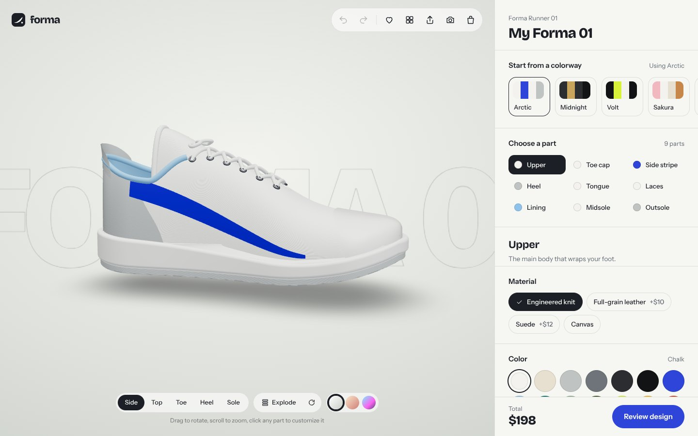
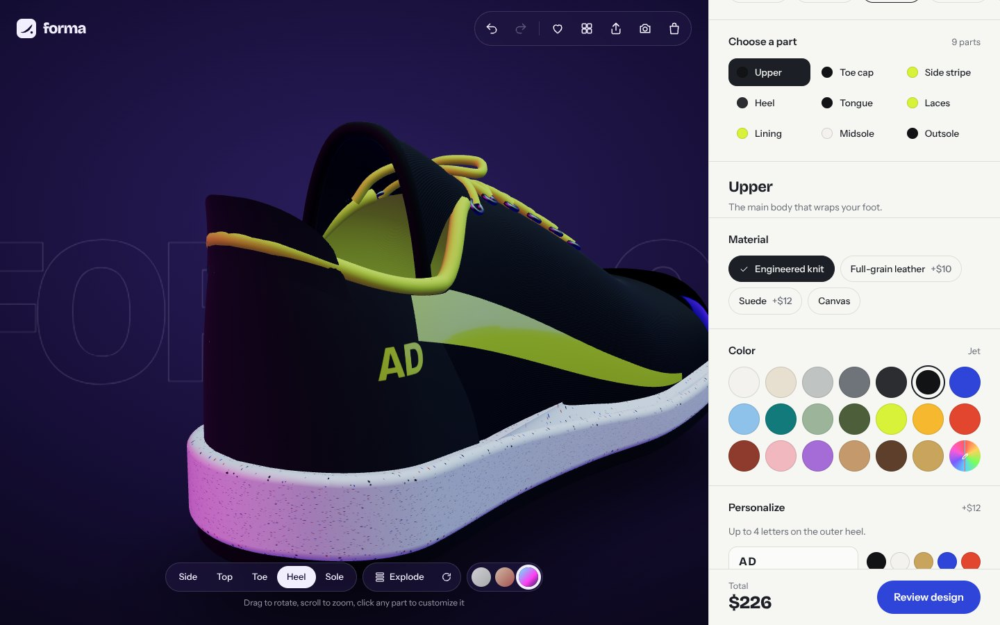
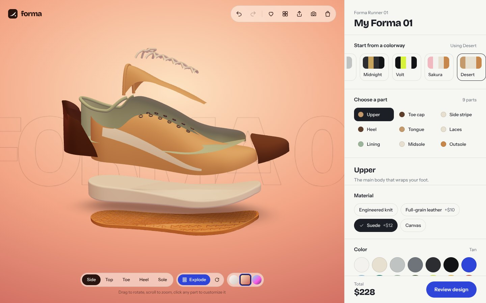
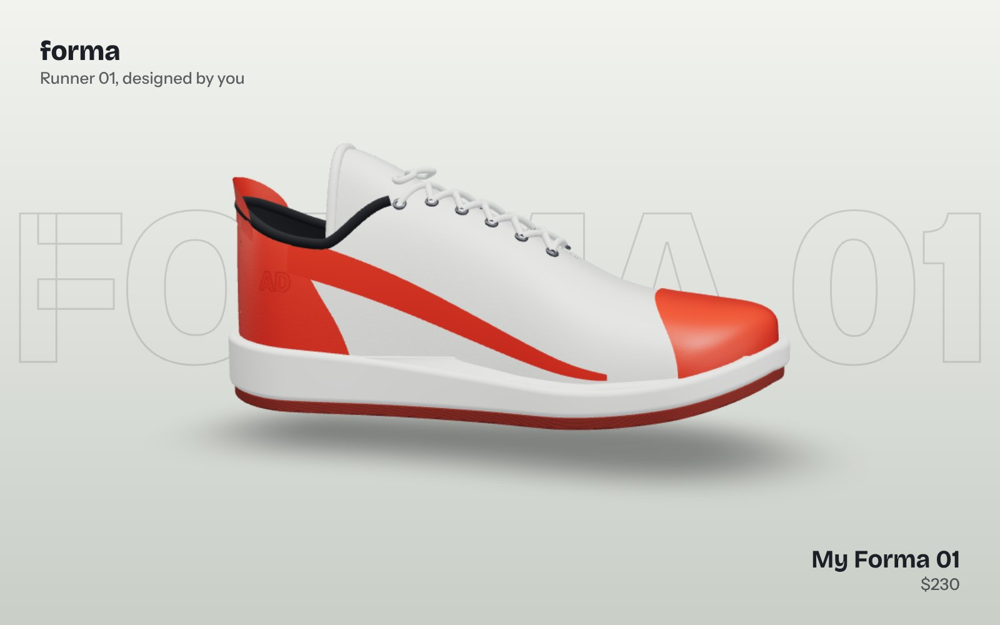
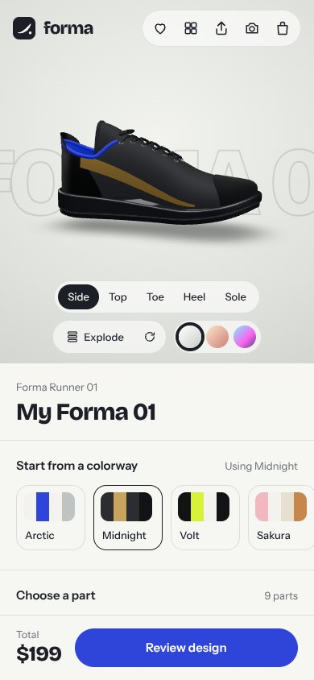

# Forma Studio

**Design your own sneaker in real-time 3D.** Pick any of 9 parts, change its color and material, add your initials, switch the lighting, explode the shoe into pieces, then save, share or download your design.



> Live demo: _add your Vercel link here_

## Features

- **Fully custom 3D sneaker** built from code. Every part (upper, toe cap, side stripe, heel, tongue, laces, lining, midsole, outsole) is its own mesh, so each one can be colored separately.
- **Real materials**: engineered knit, full-grain leather, suede, patent, canvas, metallic, reflective laces, speckled foam, gum rubber. Surface detail (knit stitches, leather grain, sole tread) is generated on the fly, so the project ships with zero image or model files.
- **Click the shoe itself**: hover a part to highlight it, click it and the camera flies to that part while the panel switches to it.
- **Exploded view**: every part floats apart to show how the shoe is built (press `E`).
- **Three lighting moods**: Studio, Sunset and Neon, with matching backgrounds.
- **Initials on the heel**, printed as a decal that wraps the curved surface.
- **6 ready colorways** (Arctic, Midnight, Volt, Sakura, Desert, Ember) to start from.
- **Undo / redo** with `Ctrl+Z` / `Ctrl+Shift+Z`.
- **Share link**: the whole design is encoded in the URL, so anyone who opens it sees the exact same shoe. No database needed.
- **Download a poster** of your design as a PNG.
- **Save designs** and a **bag with sizes and live price**, kept in the browser (demo checkout, no payment).
- **Responsive** down to phones, keyboard friendly, respects reduced motion.

| Neon light + initials | Exploded view |
| --- | --- |
|  |  |

| Downloaded poster | Mobile |
| --- | --- |
|  |  |

## Tech stack

- [Next.js](https://nextjs.org) (App Router) + TypeScript
- [Three.js](https://threejs.org) with [React Three Fiber](https://r3f.docs.pmnd.rs) and [Drei](https://drei.docs.pmnd.rs)
- [Tailwind CSS](https://tailwindcss.com) v4
- [Motion](https://motion.dev) for UI animation
- [Zustand](https://zustand.docs.pmnd.rs) for state
- Self-hosted fonts: Bricolage Grotesque and Instrument Sans (via Fontsource)

## Run it locally

You need Node.js 20 or newer.

```bash
npm install
npm run dev
```

Open http://localhost:3000.

## Deploy to Vercel

1. Push this folder to a new GitHub repository.
2. On [vercel.com](https://vercel.com), click **Add New → Project** and import the repository.
3. Keep the default settings (Vercel detects Next.js) and click **Deploy**.

## How the 3D shoe is made

Everything lives in `src/lib/geometry.ts`. The shoe starts from a mathematical "last" (the foot-shaped form shoemakers build around): width, height and toe spring are smooth curves along the length of the shoe. The upper, toe cap, side stripe, heel counter and tongue are all surfaces sampled from that same last, pushed outward by a few millimetres, which is why the overlays sit perfectly on the shoe. Laces are tubes that criss-cross between the eyelets, and the soles are extruded from the footprint outline with a thicker heel.

## Project structure

```
src/
  app/                 page, layout, global styles, icon
  components/
    Studio.tsx         page layout, keyboard shortcuts, share-link loading
    three/Scene.tsx    canvas, lighting moods, camera moves
    three/Sneaker.tsx  parts, materials, hover, exploded view, initials
    ui/                top bar, side panel, stage controls, dialogs
  lib/
    config.ts          parts, materials, colors, colorways, prices, share encoding
    geometry.ts        the procedural sneaker
    textures.ts        generated surface textures
    store.ts           app state, undo/redo, saved designs, bag
    capture.ts         thumbnails and poster download
```

## Credits

Designed and built by **Arooj Dogar**.
